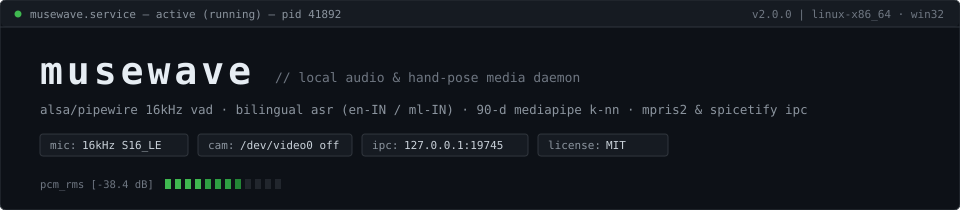
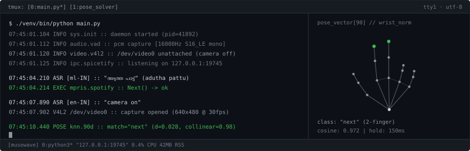

<div align="center">



<br/>

**Touchless Media Daemon for Linux & Windows — Bilingual ASR (`en-IN` / `ml-IN`), 90-D Hand-Pose Geometry & Spicetify IPC**  
`NO_WEB_API` · `NO_PREMIUM_REQUIRED` · `ZERO_TELEMETRY` · `CAMERA_OFF_BY_DEFAULT`

[](https://python.org)
[](https://github.com/uditya22-flux/muse_wave/releases)
[](https://mediapipe.dev)
[](https://spicetify.app)
[-111111?style=flat-square&logo=github&logoColor=00F0FF)](https://github.com/uditya22-flux/muse_wave/releases/tag/v2.0.0)
[](LICENSE)

</div>

---

<div align="center">
  
</div>

---

## 0x01 // OVERVIEW

`musewave` is a low-overhead Linux daemon that controls media playback across **Spotify**, **YouTube** (Chromium/Brave/Firefox), and **VLC** without touching the keyboard or paying for Spotify Web API access.

1. **Voice-First Privacy Architecture**: Launches with `/dev/video0` completely unattached. The webcam hardware LED remains off until explicitly attached via voice (`"camera on"`) or CLI flag (`--show` / `--camera`).
2. **Parallel Bilingual ASR (`en-IN` + `ml-IN`)**: Segments speech via an adaptive RMS Voice Activity Detector (VAD) over raw 16kHz PCM frames from ALSA/PipeWire, dispatching concurrent recognition threads for **English**, **Malayalam (`മലയാളം`)**, and **Manglish**.
3. **90-D Geometric Hand-Pose Classifier**: Augments MediaPipe's 63-D wrist-normalized 3D skeleton with 27-D `2.5x` weighted finger-curl vectors (`MCP->TIP`, `PIP->TIP`) and rotation-invariant collinearity checks.
4. **Spicetify Native IPC Bridge**: Injects `musewave.js` into the Spotify client to execute native `Spicetify.Player.toggleHeart()` / `LibraryAPI` calls (saving tracks directly to Spotify *Liked Songs*) and render in-app HUD notifications over `127.0.0.1:19745`.

---

## 0x02 // REPOSITORY TOPOLOGY & BRANCHES

| Branch | Target | Stack Composition |
| :--- | :--- | :--- |
| **`main`** *(default)* | Hybrid Daemon | Full Voice (`en-IN` + `ml-IN`) + On-Demand 3D Hand Gestures + Spicetify IPC + MPRIS2 Router |
| **`voice`** | Audio-Only | Continuous ALSA/PipeWire VAD + Bilingual ASR daemon with V4L2 camera disabled |
| **`gesture`** | Vision-Only | MediaPipe 90-D cosine matcher + interactive OpenCV gesture trainer (`gesture_trainer.py`) |

```bash
git clone -b main    https://github.com/uditya22-flux/muse_wave.git  # hybrid (voice + gesture)
git clone -b voice   https://github.com/uditya22-flux/muse_wave.git  # voice-only branch
git clone -b gesture https://github.com/uditya22-flux/muse_wave.git  # gesture-only branch
```

---

## 0x03 // SYSTEM ARCHITECTURE

```text
+-----------------------------------------------------------------------------------+
|                                 main.py (CORE LOOP)                               |
+-----------------------------------------+-----------------------------------------+
                                          |
                 +------------------------+------------------------+
                 |                                                 |
                 v [ALWAYS ACTIVE]                                 v [ON-DEMAND: "camera on"]
+----------------------------------------+       +----------------------------------------+
| voice_controller.py                    |       | gesture_detector.py                    |
| -------------------------------------- |       | -------------------------------------- |
| * arecord 16kHz S16_LE mono pipe       |       | * MediaPipe 21x3D hand skeleton        |
| * Rolling RMS noise floor + VAD        |       | * 63-D wrist-origin scale normalization|
| * Concurrent en-IN & ml-IN ASR workers |       | * +27-D (2.5x) MCP/PIP->TIP curl vecs  |
| * English + Malayalam + Manglish lexer |       | * Rotation-invariant 2-finger solver   |
+-------------------+--------------------+       +--------------------+-------------------+
                    |                                                 |
                    +------------------------+------------------------+
                                             |
                                             v
+-----------------------------------------------------------------------------------+
|                          spotify_controller.py (DISPATCH)                         |
+-----------------------------------------+-----------------------------------------+
                                          |
                 +------------------------+------------------------+
                 |                                                 |
                 v [D-BUS / PIPEWIRE]                              v [HTTP IPC :19745]
+----------------------------------------+       +----------------------------------------+
| OS MEDIA LAYER                         |       | spicetify_extension/musewave.js        |
| -------------------------------------- |       | -------------------------------------- |
| * playerctl (Spotify / YouTube / VLC)  |       | * Polls GET 127.0.0.1:19745/poll       |
| * Direct org.mpris.MediaPlayer2 D-Bus  |       | * Spicetify.Player.toggleHeart()       |
| * wpctl @DEFAULT_AUDIO_SINK@ / amixer  |       | * Spicetify.Platform.LibraryAPI.add()  |
| * notify-send desktop OSD              |       | * Spicetify.showNotification() HUD     |
+----------------------------------------+       +----------------------------------------+
```

---

## 0x04 // VOICE COMMAND LEXICON (`en-IN` + `ml-IN`)

Both `en-IN` and `ml-IN` recognizers evaluate each VAD frame in parallel. No mode switching is required.

| Opcode | Malayalam (`മലയാളം`) | Manglish / Transliterated | English Tokens |
| :--- | :--- | :--- | :--- |
| `PLAY_PAUSE` | `പാട്ട് വെക്കൂ`, `പാടൂ`, `നിർത്തൂ`, `മതി`, `നില്ല്` | `pattu vekku`, `padu`, `nirthu`, `mathi`, `nillu` | `play`, `pause`, `stop`, `resume` |
| `NEXT_TRACK` | `അടുത്ത പാട്ട്`, `അടുത്തത്`, `മാറ്റൂ`, `വേറെ പാട്ട്` | `adutha pattu`, `aduthathu`, `maattu`, `vere pattu` | `next`, `skip`, `next song`, `forward` |
| `PREV_TRACK` | `മുമ്പത്തെ പാട്ട്`, `കഴിഞ്ഞ പാട്ട്`, `പിന്നോട്ട്` | `mumbathe pattu`, `kazhinja pattu`, `pinnottu` | `previous`, `back`, `go back`, `last song` |
| `VOL_UP` | `ശബ്ദം കൂട്ടൂ`, `സൗണ്ട് കൂട്ടൂ`, `കൂട്ടൂ`, `ഒച്ച കൂട്ടൂ` | `shabdham koottu`, `sound koottu`, `koottu` | `volume up`, `louder`, `increase volume` |
| `VOL_DOWN` | `ശബ്ദം കുറയ്ക്കൂ`, `സൗണ്ട് കുറയ്ക്കൂ`, `കുറയ്ക്കൂ`, `പതുക്കെ` | `shabdham kurakku`, `kurakku`, `pathukke` | `volume down`, `quieter`, `lower volume` |
| `SAVE_TRACK` | `ഇഷ്ടമായി`, `ഇഷ്ടപ്പെട്ടു`, `നല്ല പാട്ട്`, `പൊളി പാട്ട്` | `ishtamayi`, `ishtapettu`, `nalla pattu`, `poli pattu` | `save`, `like`, `save song`, `like song` |
| `CAM_ATTACH` | `ക്യാമറ ഓൺ`, `ക്യാമറ തുറക്കൂ` | `camera on`, `camera thurakku` | `camera on`, `turn on camera`, `gestures on` |
| `CAM_DETACH` | `ക്യാമറ ഓഫ്`, `ക്യാമറ നിർത്തൂ`, `ക്യാമറ അടക്കൂ` | `camera off`, `camera nirthu`, `camera adakku` | `camera off`, `turn off camera`, `gestures off` |

---

## 0x05 // VISION ENGINE & 90-D FEATURE VECTORIZATION

### Gesture Table

| Profile ID | Topology | Target Opcode | Solver |
| :--- | :--- | :--- | :--- |
| `pause` | Closed fist (all 5 digits curled) | `PLAY_PAUSE` | 90-D Top-3 Cosine (`>= 0.82`) |
| `next` | Index + Middle extended, positive X-tilt | `NEXT_TRACK` | Collinearity Solver + 90-D Cosine |
| `prev` | Index + Middle extended, negative X-tilt | `PREV_TRACK` | Collinearity Solver + 90-D Cosine |
| `volume up` | 5 digits extended (open palm / dorsal) | `VOL_UP` | 90-D Top-3 Cosine (`>= 0.82`) |
| `volume down` | Single index extended (`dy(4,8) > 0.40`) | `VOL_DOWN` | Geometric Gate + 90-D Cosine |
| `save` | Thumb extended OR Thumb+Index crossed | `SAVE_TRACK` | 90-D Cosine + 1.5s Hold Buffer |

### Feature Vector Construction

Raw 21-point MediaPipe coordinates $(x_i, y_i, z_i)$ are invariant-normalized relative to the wrist origin $P_0$ and scaled by the palm span $\|P_9 - P_0\|_2$. To prevent cross-talk between open-palm and partial-finger poses, 9 articulation vectors (`MCP -> TIP` and `PIP -> TIP`) are weighted by $\alpha = 2.5$ and concatenated into a 90-dimensional feature vector:

```python
def _to_feature(vec: np.ndarray) -> np.ndarray:
    pts = np.asarray(vec, dtype=float).reshape(21, 3)
    fingers = np.concatenate([
        pts[4] - pts[2],   pts[8] - pts[5],   pts[12] - pts[9],  pts[16] - pts[13], pts[20] - pts[17],
        pts[8] - pts[6],   pts[12] - pts[10], pts[16] - pts[14], pts[20] - pts[18],
    ])
    return np.concatenate([pts.flatten(), fingers * 2.5])
```

### Rotation-Invariant Digit Extension Check

To classify 2-finger directional poses (`next` vs `prev`) at arbitrary wrist angles ($0^\circ \dots 90^\circ$), digit extension is evaluated via radial distance from the wrist origin and segment collinearity between $\vec{v}_1 = P_{\text{PIP}} - P_{\text{MCP}}$ and $\vec{v}_2 = P_{\text{TIP}} - P_{\text{PIP}}$:

$$\frac{\vec{v}_1 \cdot \vec{v}_2}{\|\vec{v}_1\|_2 \, \|\vec{v}_2\|_2} > 0.50 \quad \land \quad \|P_{\text{TIP}} - P_0\|_2 - \|P_{\text{PIP}} - P_0\|_2 > 0.15$$

---

## 0x06 // BUILD & EXECUTION

### 1. Dependencies

```bash
# System packages (Ubuntu / Debian)
sudo apt update && sudo apt install -y playerctl alsa-utils libnotify-bin

# Python environment
git clone https://github.com/uditya22-flux/muse_wave.git
cd muse_wave
python3 -m venv venv
./venv/bin/pip install opencv-python mediapipe numpy SpeechRecognition python-dotenv
```

### 2. Runtime Modes

```bash
# [MODE 1] Headless Voice-First Daemon (Webcam OFF by default)
./venv/bin/python main.py

# [MODE 2] Voice + Live OpenCV Skeleton HUD (Webcam ON)
./venv/bin/python main.py --show

# [MODE 3] Interactive Gesture Trainer (Record/Test custom 3D poses)
./venv/bin/python gesture_trainer.py

# [MODE 4] Patch Spicetify with Musewave IPC Extension
bash setup_spicetify.sh
```

### 3. Trainer Keymap (`gesture_trainer.py`)

```text
MAIN MENU                          RECORDING STATE
--------------------------------   --------------------------------
[N]      Create new gesture        [R]      Capture 30 frames (2.5s)
[T]      Live classifier test      [A]      Append multi-angle pass
[L]      Inspect gesture table     [F]      Flush & write JSON
[D]      Pop last gesture          [B]/[Q]  Abort / return to menu
[Q]/[B]  Exit trainer
```

---

## 0x07 // FILE MANIFEST

```text
muse_wave/
├── main.py                        # Core daemon loop & V4L2 / Voice state machine
├── voice_controller.py            # ALSA/PipeWire PCM reader, adaptive VAD & dual ASR
├── gesture_detector.py            # 90-D feature pipeline & cosine/geometric classifiers
├── gesture_trainer.py             # OpenCV sample recorder & live telemetry HUD
├── spotify_controller.py          # MPRIS2 target router, wpctl volume & :19745 HTTP server
├── gesture_config.json            # Serialized 63-D landmark training matrices
├── spicetify_extension/
│   └── musewave.js                # Injected Spicetify client bridge
├── setup_spicetify.sh             # User-space Spicetify patcher (no root required)
├── launch_with_spotify.sh         # Process watchdog tied to Spotify lifecycle
├── spotify.desktop                # XDG desktop entry for automatic daemon attach
└── LICENSE                        # MIT License
```

---

## 0x08 // LICENSE

Distributed under the **[MIT License](LICENSE)**. Copyright (c) 2026 **Uditya Krishna**.
